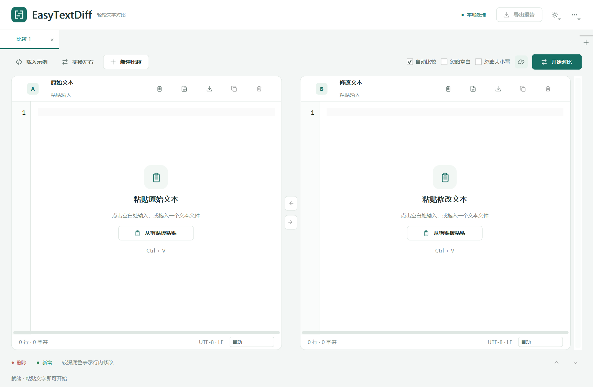
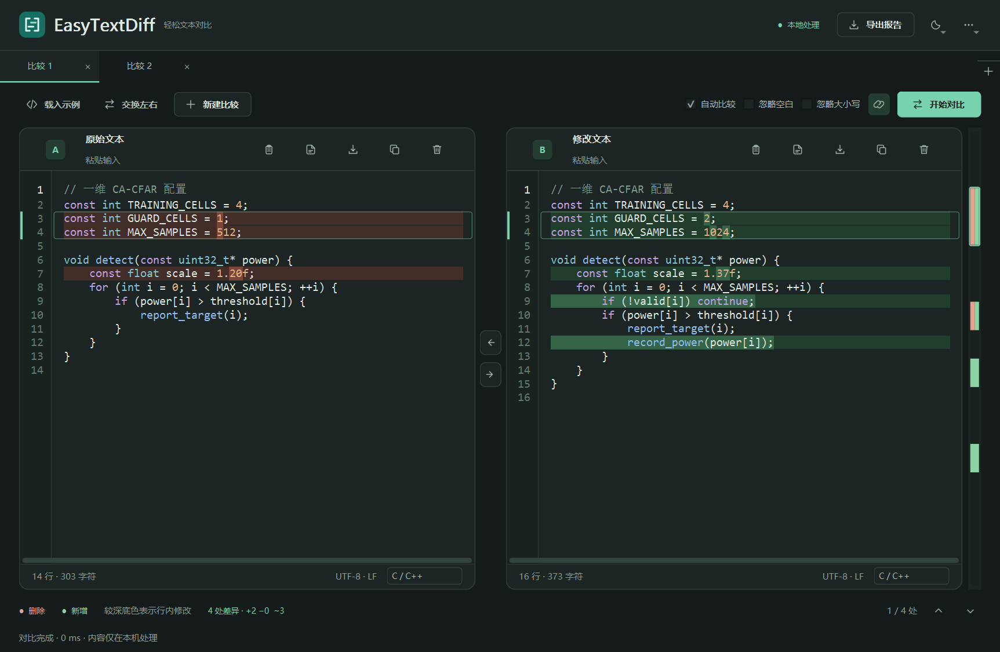

# 轻松文本对比 EasyTextDiff

轻松文本对比 EasyTextDiff 1.2.3 是一个默认粘贴输入的本地文本对比工具。左右两栏始终可以编辑，差异直接显示在原文中，适合快速比较代码、TXT 和 Markdown。

A paste-first desktop text diff tool built with PyQt5. Edit both source panes directly while viewing live line and inline change highlights, with all text processed locally.

[GitHub 仓库](https://github.com/XinhaoLiu94/EasyTextDiff) · [反馈问题](https://github.com/XinhaoLiu94/EasyTextDiff/issues)



## 功能

- 启动直接输入或粘贴文字，也可拖入、打开文本文件。
- 同一对可编辑文本栏显示原始行号，标出新增、删除和行内变动，无需切换输入与查看模式。
- 停止输入约 500 ms 后在原文上更新高亮，支持关闭自动比较或立即手动重算。
- 独立多标签比较，支持点击差异概览跳转。
- Verilog / SystemVerilog、C / C++、Python、JSON 语法高亮，可自动识别或手动选择。
- 跟随 Windows 应用主题，可手动切换浅色与深色。
- 上一处 / 下一处差异导航，将当前差异应用到另一侧，支持撤销。
- 忽略空白、忽略大小写、同步滚动、查找、自动换行。
- 导出逐行对齐的独立 HTML 报告，复制 unified diff，保存任一侧文本。
- 保存前保留原编码、BOM 和换行；另存为可选择格式，关闭前提示未保存修改。
- 文本在本机处理；不自动保存输入或恢复会话，仅记住外观、窗口大小和自动比较偏好。

当前已在 **Windows、Python 3.12、PyQt5 5.15** 上验证。其他系统尚未完成适配验证。



[查看浅色差异界面](docs/screenshots/diff-light.png)

## 运行

### Windows 便携版

解压完整的便携包，双击 `EasyTextDiff.exe`。请保留旁边的 `_internal` 文件夹，复制时携带整个 `EasyTextDiff` 文件夹。目标电脑无需安装 Python。

### 从源码运行

推荐 Python 3.12。克隆仓库并运行：

```powershell
git clone https://github.com/XinhaoLiu94/EasyTextDiff.git
cd EasyTextDiff
python -m venv .venv
.\.venv\Scripts\python.exe -m pip install -e .
.\.venv\Scripts\python.exe -m easytextdiff
```

安装项目后，在同一 Python 环境中可用 `python -m easytextdiff --demo` 查看示例，或用 `python -m easytextdiff left.txt right.txt` 打开两个文件。安装还会提供 GUI 启动命令 `easytextdiff`；虚拟环境未激活时可运行 `.\.venv\Scripts\easytextdiff.exe`。

## 快捷键

| 操作 | 快捷键 |
| --- | --- |
| 开始 / 重新对比 | Ctrl+Enter 或 F5 |
| 上一处 / 下一处差异 | F7 / F8 |
| 新建比较 | Ctrl+N |
| 关闭当前比较 | Ctrl+W |
| 保存当前侧 | Ctrl+S |
| 当前侧另存为 | Ctrl+Shift+S |
| 向当前栏导入文件 | Ctrl+O |
| 查找当前栏 | Ctrl+F |
| 隐藏查找栏 | Esc |

直接在左右两栏编辑原文，差异高亮显示在同一处。中间的左右箭头仅将当前选中的差异块应用到目标栏；合并后仍可继续编辑，并直接用 Ctrl+Z 撤销。

自动比较在停止输入约 500 ms 后更新原文高亮与概览，保持输入焦点。手动比较、差异跳转和点击概览也都使用这两栏，不另开只读视图。每个标签独立保存内容、比较选项和结果；新建比较会打开新标签。

两侧保留各自的原始行数，不插入用于对齐的空白占位行。差异导航与同步滚动根据对应关系定位，因此两侧屏幕行不保证严格水平对齐；导出的 HTML 报告仍按比较结果对齐。差异装饰不替换编辑器中的原文，光标、中文输入与撤销沿用原生编辑器行为。

## 文本格式与边界

- 支持纯文本；Word、PDF 等格式需要先提取文字。
- 文件导入支持 UTF-8、带 BOM 的 UTF-16 和 GB18030，单个文件最大 4 MB。
- 换行内部统一为 LF；普通保存保持原编码、BOM 与换行，另存为可选择 UTF-8 / UTF-8 BOM / UTF-16 LE 或 BE BOM / GB18030，以及 LF / CRLF / CR。
- 混合换行文件未修改时按原始字节保存，编辑后统一换行前提示确认。编码不支持的字符会报错，不进行有损替换。
- 同路径保存检测文件是否被外部修改，确认后才覆盖。比较仍针对文本内容，不是字节级比较。
- 输入末尾是否换行会作为差异处理。
- 超大或高度重复的输入采用较粗粒度的差异块，以限制耗时；原文和合并范围仍保留。
- “忽略空白 / 大小写”影响界面中的差异高亮；导出的 unified diff 始终反映原文的真实差异。
- 导入与比较不会覆盖原文件，只有明确选择保存才会写入文件。

## 开发与测试

```powershell
.\.venv\Scripts\python.exe -m unittest discover -s tests -v
```

自动化环境可设置 `QT_QPA_PLATFORM=offscreen`。Windows 离屏平台可能没有可用字体，不能用离屏截图代替实际窗口的视觉检查。

仓库包含 Windows 自动测试配置：先执行 `pip install -e .` 安装项目，再运行 unittest。测试通过正常包导入访问 `easytextdiff`，无需修改 `sys.path`。修改界面后还应检查实际窗口的浅色、深色和最小尺寸布局。贡献步骤见 [CONTRIBUTING.md](CONTRIBUTING.md)，构建命令见 [PACKAGING.txt](PACKAGING.txt)。

维护者首次建立仓库时可参考 [发布步骤](docs/PUBLISHING.md)。版本变更见 [CHANGELOG.md](CHANGELOG.md)。

采用会话级 MVP 与应用服务分层，职责边界和异步状态说明见 [架构说明](docs/ARCHITECTURE.md)。

## 项目结构

```text
pyproject.toml          包配置、依赖与 GUI 启动入口
src/easytextdiff/       应用包
  __init__.py          包初始化
  __main__.py          python -m easytextdiff 入口
  app.py               应用初始化与装配
  branding.py          统一名称与版本
  preferences.py       用户偏好与旧版设置迁移
  main_window.py       标签、公共菜单与主题
  presenter.py         会话交互与操作协调
  session_view.py      单个比较标签的界面
  models.py            文档、格式与保存基线
  file_service.py      解码、格式保留与原子保存
  tasks.py             比较任务、防抖与版本控制
  diff_engine.py       对比、差异块合并与补丁导出
  editor.py            原文编辑、行号、差异装饰和定位
  highlighting.py      代码语法高亮
  overview.py          差异概览
  dialogs.py           保存格式与确认弹窗
  widgets.py           双栏编辑面板
  styles.py            浅色与深色样式
  icons.py             SVG 图标
  reports.py           HTML 报告
  examples.py          内置示例文本
scripts/
  build_windows.py     Windows 便携版构建
assets/
  app.ico              Windows 应用图标
tests/                  算法、编辑器和界面集成测试
docs/                   架构、发布说明与截图
requirements.txt        运行时依赖规格
requirements-build.txt  构建工具版本
```

## 许可与来源

本项目采用 **GPL-3.0-or-later**，全文见 [LICENSE.txt](LICENSE.txt)。这是独立的 PyQt5 实现，未包含 WinMerge 源码。

PyQt 使用 GPL v3 / 商业双许可；本项目沿用 GPL 开源发布方式。依赖的许可分别适用，参见 [PyQt 官方说明](https://www.riverbankcomputing.com/software/pyqt/intro)。分发便携版时请保留其源码和依赖许可说明。
