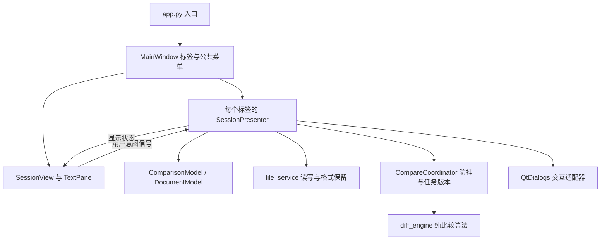

# 轻松文本对比 EasyTextDiff 架构

## 架构选择

1.0 的对比引擎已独立，但 MainWindow 同时构建界面、读写文件、安排任务和维护状态，属于以窗口为中心的事件驱动结构，并非严格 MVC。

从 1.1 开始采用**会话级 MVP 加应用服务分层**；1.2 在同一职责边界内将输入和差异显示统一为始终可编辑的原文栏。每个比较标签由一份模型、一个 View 和一个 Presenter 组成。主窗口作为应用外壳管理标签和全局外观，入口装配应用。这里的 MVP 是应用自身的职责划分；它不等同于 Qt 的 QAbstractItemModel / item-view 体系。

## 模块边界

| 模块 | 职责 | 不承担的工作 |
| --- | --- | --- |
| app.py | 命令行入口、QApplication 初始化 | 文档操作和比较业务 |
| branding.py / preferences.py | 统一应用身份、偏好读取与一次性迁移 | 文档内容、文件比较与界面布局 |
| main_window.py | 标签生命周期、全局菜单、主题、窗口偏好 | 解码、写文件、差异算法 |
| session_view.py / widgets.py | 创建控件、显示状态、发出操作意图、滚动和查找 | 读取或保存文件、启动比较任务 |
| presenter.py | 协调会话、修改保护、保存决策、结果和导航状态 | 构建窗口布局、实现解码与差异算法 |
| models.py | 原文、路径、格式、保存基线与修改状态 | Qt 控件、弹窗和文件系统操作 |
| file_service.py | 严格解码、格式保留、原子保存、外部变更检查 | 弹窗和用户决策 |
| tasks.py | 防抖、线程任务、版本校验、关闭后的结果丢弃 | 访问控件或决定保存行为 |
| diff_engine.py | 对比、差异块应用、统一补丁 | Qt 和文件系统 |
| editor.py / highlighting.py / overview.py | 原文编辑、差异装饰、语法着色、概览绘制与定位信号 | 保存决策和会话生命周期 |
| dialogs.py | 文件选择、保存格式、确认和错误展示 | 修改文档基线或写文件 |
| reports.py | 生成转义后的 HTML 文本 | 选择路径和写文件 |

暂时保留平坦的 Python 模块结构，避免为少量类增加包层级。新增功能按职责进入相应模块；不再把文件服务或对比业务放回主窗口。

## 两种修改状态

- **文档 modified**：内容或格式相对成功加载 / 保存的基线有变化。用于标签标记、关闭确认和保存。撤销回基线后恢复为未修改。
- **比较 dirty**：当前内容或比较选项与最新结果不一致。用于禁用过期的合并和报告操作。

这两个状态独立。比较成功不会把文档标记为已保存；保存成功也不意味着内容需要重新比较。

## 编辑与异步结果

编辑器产生 textEdited 信号后，Presenter 更新对应文档模型并使旧比较失效。自动比较启用时，停止输入约 500 ms 后提交快照；手动比较立即提交。

后台只处理不可变文本与选项快照。每次请求更新任务版本，旧版本结果不能覆盖新输入。关闭标签会停止防抖并作废后续结果；主窗口关闭前先检查全部标签。

自动完成后在同一对源码编辑器中更新差异高亮和概览，保持输入焦点；手动比较、差异导航和概览点击也使用这两个编辑器。没有输入 / 查看模式切换，也没有额外的只读对齐文档。

## 原文与差异行映射

每侧编辑器只持有该侧真实原文，保留原始行数。新增、删除和行内差异作为可丢弃的显示装饰附着到原始位置，不向文档插入对齐空行，也不通过替换全文更新高亮。光标、中文输入、选择与撤销继续使用原生编辑器行为。

比较引擎的 DiffRow 描述两侧行的对应关系；其中某侧缺行表示插入或删除，不代表该侧文档中存在空白行。视图使用这份映射将差异块、概览点击和同步滚动定位到实际原文行或最近的插入边界。编辑立即使旧结果与装饰失效，新的结果到达后重新建立映射。

1.2 的可编辑界面不保证两侧屏幕行严格水平对齐。HTML 报告仍使用比较行生成对齐的静态表格。原文、显示映射与导出报告因此保持各自清晰的职责。

差异合并由 Presenter 选择当前有效差异块，通过引擎得到目标原文，再以原生编辑操作应用到同一栏。合并进入该栏的撤销历史，用户可直接 Ctrl+Z；模型和显示状态经正常编辑信号更新，文件只在明确保存时写入。

## 保存与文件格式

模型内部统一使用 LF；文件服务记录原编码、BOM、换行和成功读写的字节基线。普通保存保持原格式，另存为可以选择格式，编码不支持的字符会报错，不进行有损替换。

文件先写入同目录临时文件，再原子替换目标；失败不更新保存基线。同路径保存前检查外部修改，确认后才允许覆盖。混合换行文件未修改时保留原始字节，修改后统一换行前需确认。

关闭、导入替换和关闭标签都可以保存、放弃或取消；取消或保存失败会中止后续操作。新建比较打开新标签，不清空旧会话。

## 测试与扩展

模型和文件服务测试不需要 Qt。任务测试验证防抖、旧结果和销毁；Presenter 测试注入假弹窗，检查真实文件读写与取消路径；视图测试检查直接编辑、原文与行数保持、差异装饰、映射导航、合并撤销、标签隔离和复制。界面改动另做实际字体环境中的浅色、深色和最小尺寸检查。

文件夹比较、三方合并、会话恢复和外部变更主动监视尚未实现。未来应增加专门的模型、服务和 Presenter，不扩大现有 SessionPresenter 来承载全部业务。
